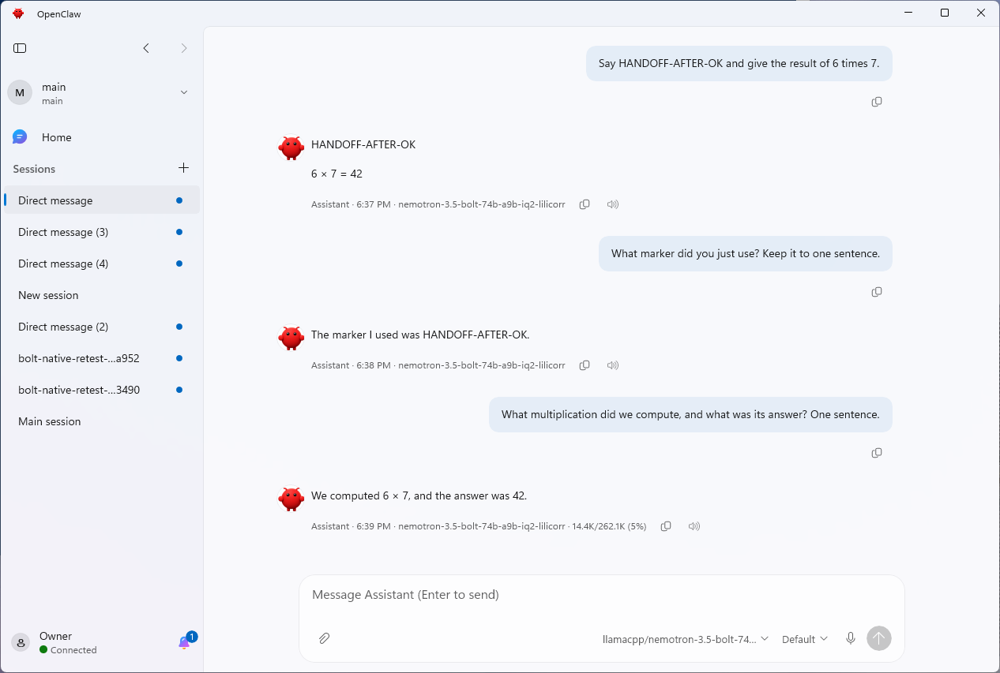

# Setup Chat handoff validation

- [Reproduction](#reproduction)
- [Regression](#regression)
- [Runtime result](#runtime-result)
- [Validation](#validation)
- [Limits](#limits)

## Reproduction

On native Windows ARM64 with a native Gateway and cached Nemotron Bolt, open
Settings > Local AI > Change model, select the ordinary **Use this model** action,
then choose **Talk to my agent** from the verified Ready screen.

The before run used `c6d7580190cd2d9db71d84c17ba44f1c98a0c432`; its affected
lifecycle, native transport, and completion verifier are identical to main at
`50d0b34a4e71a51286ad5346b57a388ebf805fd6`.
A passive observer followed the restarted app for 135.49 seconds across 63
samples. Chat never became visible or foreground; no sample had a locked desktop.
The handoff entered `retry` and reported:

```text
Native setup destination failed (InvalidOperationException); phase: none; result: Unavailable.
Could not open your setup destination
```

The error banner appeared alongside an otherwise Connected Gateway after manually
restoring Settings. That manual restoration was after the observation ended.

A native managed-card run on `2dba6aa580322972878c6ee7077c9708053d11a2`
also reproduced the startup failure. The client exposed its `hello-ok` snapshot
at 23:56:08 UTC, verification failed before the connection owner completed its
handshake callback, and the router process started at 23:56:46 UTC. The handoff
entered retry about five seconds after restart. Chat never appeared across 37
post-restart samples spanning 78.50 seconds, then observation stopped after the
terminal retry state. The observer performed no activation or input after the
final click. This separates the
connection-owner readiness race from the later model-recovery wait.

## Regression

Run the same four handoff cases against the original lifecycle and the changed
lifecycle. The fixture explicitly enables automatic recovery for the confirmed
ordinary-selection receipt, as the product flow does.

| Case | Original | Changed |
| --- | --- | --- |
| Ordinary selection, wait for recovery | Fails: completed immediately | Pass |
| Ordinary selection, cancel recovery wait | Fails: completed immediately | Pass |
| Explicit managed selection, wait | Pass | Pass |
| Explicit managed selection, cancel | Pass | Pass |

Both native connection contracts also have a controlled real-WebSocket
regression: pause immediately before the client's `HandshakeSucceeded` event,
assert the client exposes its handshake while the owner is still Connecting,
and begin post-restart verification. Both cases fail before the owner-ready
check and pass with it. The existing tests then verify that unowned endpoints
and changed Gateway authority still fail without replacing the borrowed client.

The throw site is `GatewayConnectionManager.RequireNativeSetupClientAsync`:
its `RequireCurrent` guard rejects a connection whose owner is still Connecting.
The old `BorrowNativeAsync` loop stopped when the client's handshake snapshot
appeared, before the manager handled `HandshakeSucceeded`. The change waits for
both existing readiness facts; it does not lengthen the timeout or retry a failed
handoff automatically.

Receipt regressions also cover malformed JSON, an empty file, and a locked file:
all three fail before the ordinary-selection guard and pass afterward. Managed
selection still rejects these receipts, and actual Gateway model verification
still runs for ordinary selection and rejects an unavailable model.

Two further cases cover a readable receipt for a different endpoint or signing
identity. Both fail before the matching-owner guard and pass afterward; the
existing pending/stopped cases continue to pass.

If already-admitted recovery finishes without a healthy managed runtime, ordinary
selection must still reach actual Gateway verification. A controlled reproducer
verified its model before and after the wait: the old implementation timed out,
while the changed implementation returned with zero runtime calls and zero extra
Gateway writes. The explicit managed case continues waiting for a healthy runtime
and respects cancellation.

The full `NativeLocalAiLifecycleTests` class passes 111/111 cases, with no skips.
It also covers rejection of a different loaded model, pending receipts, stopped
intent, zero runtime starts, and no extra Gateway writes from the wait.

## Runtime result

The after run used `34f96eeb415fe4add00adc3753f4ca241c52153b` on the same
native Windows ARM64 installation, native Gateway, profile, cached Bolt model,
and installed 262,144-token context. The running executable's product version
also contained this exact commit. No model, runtime, or recipe change was needed.

This run selected the managed **Local AI on this PC > Use this model** card
(`RequiresManagedLocalAi=true`). Ordinary detected-model selection is covered by
the red/green regression above; it is not claimed as the after UI path.

From the verified Ready screen, click **Talk to my agent** once. After that
click, a passive observer only read window visibility, foreground state,
UI Automation, and last-input ticks. It did not activate windows or send input.

The managed-card comparison below uses `2dba6aa5` as Before. The original ordinary
selection reproduction is reported separately above.

| Observation | Before | After |
| --- | --- | --- |
| App restart | Yes | Yes |
| Chat visible and foreground automatically | No, across 78.50 seconds; terminal retry | Yes, 89.01 seconds after restart |
| Post-restart samples | 37 | 49 |
| Locked desktop samples | 0 | 0 |
| Handoff receipt | `retry` | Consumed |
| Selected model after handoff | Not opened | `llamacpp/nemotron-3.5-bolt-74b-a9b-iq2-lilicorr` |
| Connection in the opened Chat | Not opened | Connected |

The after run recorded one unchanged last-input tick across all 49 post-restart
samples. The observer finished after Connected Chat remained visible and
foreground for over 10 seconds.

Copied passive UI diagnostics at the successful handoff:

```text
ChatComposerInput: visible
Chat window: foreground
OwnerDetail: Connected
ChatComposerModelPicker: Model: llamacpp/nemotron-3.5-bolt-74b-a9b-iq2-lilicorr
```

Only after the observer finished, create a new conversation and send these three
prompts:

| Prompt | Actual response |
| --- | --- |
| Say HANDOFF-AFTER-OK and give the result of 6 times 7. | HANDOFF-AFTER-OK<br><br>6 × 7 = 42 |
| What marker did you just use? Keep it to one sentence. | The marker I used was HANDOFF-AFTER-OK. |
| What multiplication did we compute, and what was its answer? One sentence. | We computed 6 × 7, and the answer was 42. |

All three responses completed in the same new conversation with Bolt selected.
This is a three-turn context smoke test, not a long-duration soak test.

The screenshot was taken after the observer and three turns, using a
1920×1080 RDP desktop so the complete app fits.



## Validation

Final validation passed on native Windows ARM64 at
`34f96eeb415fe4add00adc3753f4ca241c52153b`:

| Command | Passed | Failed | Skipped |
| --- | ---: | ---: | ---: |
| `./build.ps1` | Build passed | 0 errors | n/a |
| `dotnet test ./tests/OpenClaw.Shared.Tests/OpenClaw.Shared.Tests.csproj --no-restore` | 4,428 | 0 | 34 |
| `dotnet test ./tests/OpenClaw.Tray.Tests/OpenClaw.Tray.Tests.csproj --no-restore` | 4,239 | 0 | 0 |
| `dotnet test ./tests/OpenClaw.SetupEngine.Tests/OpenClaw.SetupEngine.Tests.csproj --no-restore` | 2,392 | 0 | 1 |
| `./scripts/validate-mxc-e2e.ps1 -NoBuild` | 18 | 0 | 0 |

Each unit test project was built before its `--no-restore` test run. The strict
MXC run did not use `-AllowSkip`; its real Gateway execution and blocked-write
proofs both passed. The 35 unit skips are gated tests, not the focused regressions.

## Limits

This is focused native Gateway/Bolt handoff proof. It does not establish the
outcome of a clean Store installation with a WSL Gateway and another model.
