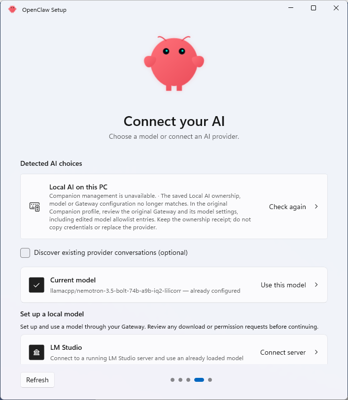
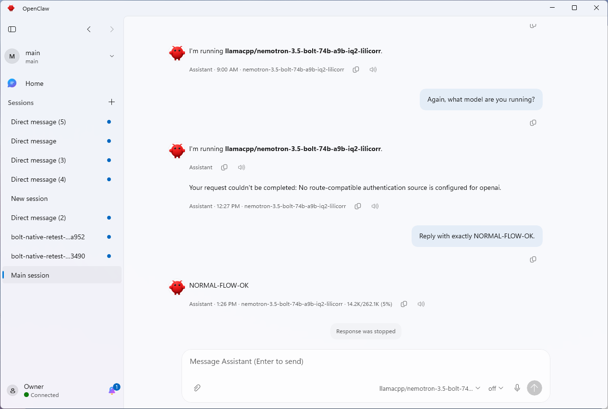

# Ordinary detected-model setup handoff proof

- [Environment and route](#environment-and-route)
- [Passive observation](#passive-observation)
- [Evidence](#evidence)
- [Validation scope](#validation-scope)

## Environment and route

Feature head: `34f96eeb415fe4add00adc3753f4ca241c52153b`.
Windows 11 ARM64 on RTX Spark N1X, native Gateway MSIX `2026.10.400.0`
(payload `2026.10.4`), llama.cpp `b11700`, cached Nemotron 3.5 Bolt IQ2/LiLiCorr,
and the retained 262,144-token context. The executable product version was
checked against the exact feature head.

This is the ordinary detected **Use this model** route, distinct from the
[earlier managed-card run](README.md).

The exact-owned configuration initially collapsed the ordinary candidate into
the managed Local AI card. To expose the ordinary candidate, a temporary
`meta.lastTouchedVersion` build suffix was added to the existing Gateway configuration.
Only that existing, schema-supported metadata string changed; the provider,
model, credentials, runtime, context and existing ownership receipt were
preserved. This represents a Gateway configuration revision that needs
management reconciliation while ordinary model use remains available. At
Ready, the complete Gateway configuration was restored byte-for-byte to
the original before the final restart action, leaving the ordinary selection
and its verified model intact.
The earlier rejected attempt to use an unsupported metadata field was restored
byte-for-byte before this successful route attempt; it is not handoff evidence.

1. Open Settings > Local AI > Change model.
2. Select the Bolt action under **Detected AI choices**, leaving the managed
   **Local AI on this PC** action untouched.
3. Wait for **Your AI is ready**, then click **Talk to my agent** once.
4. Send no further input until the passive observer finishes.

## Passive observation

The ordinary selection produced a real handoff receipt with:

```text
RequiresManagedLocalAi: false
ModelRef: llamacpp/nemotron-3.5-bolt-74b-a9b-iq2-lilicorr
State: inflight
```

The final-click command recorded success at `2026-10-20T11:46:27Z`, followed by one Companion
restart at `2026-10-20T11:46:44.1897896Z`. Connected foreground Chat first appeared
at `2026-10-20T11:49:12.2653339Z`, **148.08 seconds after restart**.
It remained connected and foreground for 11.33 seconds before
observation ended at `2026-10-20T11:49:24.0458251Z`.

| Observation | Result |
| --- | --- |
| Running executable and source | Exact feature head `34f96eeb` before and after restart |
| Selected UI route | `CandidateChoices > Current model > Use this model` |
| Managed-card action selected | No |
| Receipt management requirement | `RequiresManagedLocalAi=false` |
| Receipt model | `llamacpp/nemotron-3.5-bolt-74b-a9b-iq2-lilicorr` |
| Post-restart samples | 78 |
| Distinct post-restart last-input ticks | 1 (`403347375`, unchanged) |
| Locked desktop samples | 0 |
| Chat | Visible, foreground, Connected automatically |
| Final Chat model picker | Exact matching Bolt model |
| Handoff receipt | `ready` then `inflight`, then consumed; no `retry` sample |

The observer only read window visibility, foreground ownership, UI Automation,
last-input ticks and the allowlisted receipt fields. It sent no input or
activation calls. No further UI helper, manual Chat opening, Connect action or
click was used after the final-click command and before the observer finished.

Copied final passive diagnostics:

```text
ChatComposerInput: visible
Chat window: foreground
OwnerDetail: Connected
ChatComposerModelPicker: Model: llamacpp/nemotron-3.5-bolt-74b-a9b-iq2-lilicorr
pending.json: absent (consumed)
post-restart lastInputTick: 403347375 in all 78 samples
```

The observer's final app-window capture was taken before any subsequent input.

## Evidence

Ordinary detected action before selection. The separate managed card remains
unselected:



Automatic foreground Connected Chat captured by the passive observer:



The Chat frame shows existing main-session history, including an earlier
provider-authentication error and stopped-response placeholder. Those messages
predate this run; they are not new replies or errors from this handoff. This
focused run claims automatic handoff and model matching, not a new inference
conversation. The earlier managed-card report contains the three-turn chat proof.

## Validation scope

No source change was made for this focused proof. The feature head and its
previous successful build, Shared, Tray, SetupEngine and strict Gateway/MXC
validation remain unchanged. No broad validation rerun or managed-card repeat
was performed. This proves the provisioned native Gateway/cached Bolt route;
it does not establish a clean Store/WSL installation with another model.
